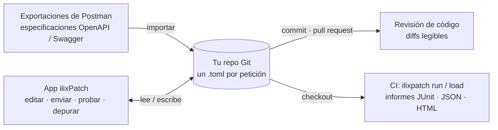

<p align="center">
  
</p>

<h1 align="center">ilixPatch</h1>

<p align="center">
  <b>El cliente de APIs de código abierto y local que vive en tu repositorio Git.</b><br>
  Una alternativa rápida a Postman: colecciones, entornos, scripts y tests <code>pm.*</code>, pruebas de carga,
  importación de OpenAPI y un cliente de Git integrado. Sin cuenta ni nube: tus peticiones son ficheros.
</p>

<p align="center">
  <a href="https://github.com/jst7/ilixPatch/actions/workflows/ci.yml"></a>
  <a href="https://github.com/jst7/ilixPatch/releases"></a>
  <a href="#licencia"></a>
  
</p>

<p align="center">
  <a href="https://github.com/jst7/ilixPatch/releases"><b>Descargar</b></a> ·
  <a href="#inicio-rápido">Inicio rápido</a> ·
  <a href="#cómo-funciona">Cómo funciona</a> ·
  <a href="docs/CLI.md">Documentación de la CLI</a> ·
  <a href="README.md">Read in English</a>
</p>

> **Estado: desarrollo temprano (0.x).** Avanza rápido y el formato en disco aún puede cambiar (está versionado).

## Por qué ilixPatch
- **Rápido y ligero:** núcleo en Rust y [Tauri](https://tauri.app), que usa el webview del sistema en lugar de un Chromium empaquetado.
- **Local:** sin registro, sin sincronización y sin telemetría. Todo vive en la carpeta de tu proyecto.
- **Pensado para Git:** un fichero TOML por petición, así que los diffs se leen bien y se revisan en pull requests. Además trae un cliente de Git al estilo de IntelliJ.
- **Compatible con Postman donde importa:** los scripts `pm.*` y las aserciones Chai funcionan sin cambios, la CLI acepta los flags de Newman y las colecciones, entornos y exportaciones completas de Postman se importan en unos clics.
- **OpenAPI / Swagger en segundos:** pega la URL de una especificación o suelta un JSON/YAML y tendrás una colección lista para enviar, con bodies de ejemplo generados a partir de los esquemas.
- **Los mismos ficheros y el mismo motor en CI:** la CLI `ilixpatch` ejecuta tus colecciones y pruebas de carga con informes JUnit, JSON y HTML.

## Inicio rápido
1. **[Descarga](https://github.com/jst7/ilixPatch/releases)** la app para macOS, Windows o Linux.
2. Trae tus peticiones con **+ › Importar (Postman, OpenAPI)…**: suelta una exportación de Postman o pega la URL de una especificación, por ejemplo
   `https://petstore3.swagger.io/api/v3/openapi.json`. También puedes abrir el ejemplo con **+ › Abrir carpeta…** → `examples/demo-project`.
3. Elige un entorno y pulsa **`⌘/Ctrl + Enter`**.

Después haz commit de la carpeta del proyecto: tu equipo tendrá las mismas peticiones con `git pull` y el CI podrá ejecutarlas:

```sh
ilixpatch run . --env staging -r cli,junit --reporter-junit-export results/junit.xml
```

Así se ve una ejecución, contra el proyecto de ejemplo (resumida):

```text
$ ilixpatch run examples/demo-project --env dev
JSONPlaceholder
❏ posts
↳ List posts
  GET https://jsonplaceholder.typicode.com/posts?userId=1 [200 OK, 2.7kB, 66ms]
  │ post_id = 1
  ✓  Status is 200
  ✓  Content-Type is JSON
  ✓  Every post belongs to the user
…
┌────────────────────┬──────────┬────────┐
│                    │ executed │ failed │
├────────────────────┼──────────┼────────┤
│         iterations │        1 │      0 │
│           requests │        7 │      0 │
│       test-scripts │        6 │      0 │
│ prerequest-scripts │        1 │      0 │
│         assertions │       14 │      0 │
└────────────────────┴──────────┴────────┘
```

## Cómo funciona
Tu espacio de trabajo es una carpeta de ficheros TOML pequeños, normalmente dentro del repositorio de la API que pruebas.
La app y la CLI leen y escriben exactamente esos ficheros: no hay base de datos ni servidor por medio.



```text
mi-api/                         ← tu repositorio
├── .ilixpatch/
│   ├── config.toml             ← marca el proyecto
│   └── environments/
│       ├── staging.toml        ← variables compartidas (en el repo)
│       └── staging.secret.toml ← tokens y contraseñas (ignorado por git)
└── users-api/                  ← una colección
    ├── collection.toml         ← variables y auth que heredan todas las peticiones
    └── users/
        └── create-user.toml    ← una petición = un fichero
```

```toml
# users-api/users/create-user.toml
name = "Create user"
method = "POST"
url = "{{baseUrl}}/users"

[body]
type = "json"
content = '''{ "name": "Ada", "email": "ada@example.com" }'''

[scripts]
tests = '''
pm.test("created", () => pm.response.to.have.status(201));
pm.environment.set("userId", pm.response.json().id);
'''
```

Las peticiones las envía un motor en Rust (reqwest + rustls), no un navegador: sin CORS, con control total de TLS,
certificados de cliente y proxies, y con errores que explican qué ha fallado.

## Si vienes de Postman
1. Exporta tus colecciones y entornos (o todo a la vez con **Settings › Data › Export data**) e impórtalos:
   se traen carpetas, auth (también la heredada), bodies y variables; los valores que parecen secretos van a ficheros ignorados por git.
2. Tus scripts de pre-request y de tests siguen funcionando: `pm.test`, `pm.expect`, `pm.response`, `pm.environment`,
   `pm.variables`, `postman.setNextRequest`, Chai…
3. En CI, cambia `newman run` por `ilixpatch run`: los flags (`-e`, `-d`, `-n`, `-r cli,junit,html`, `--bail`,
   `--folder`, `--env-var`, `--ssl-client-cert`…) y los códigos de salida son los mismos.

## En CI
La CLI es un único binario. En GitHub Actions:

```yaml
- name: Install ilixpatch
  run: |
    V=v0.4.2   # fija la versión que quieras
    curl -sSL "https://github.com/jst7/ilixPatch/releases/download/$V/ilixpatch-$V-x86_64-unknown-linux-gnu.tar.gz" | tar xz
    echo "$PWD/ilixpatch-$V-x86_64-unknown-linux-gnu" >> "$GITHUB_PATH"

- name: API tests
  run: |
    ilixpatch run . --env staging --env-var token=${{ secrets.API_TOKEN }} \
      -r cli,junit --reporter-junit-export results/junit.xml

- name: Load test (falla si p95 > 300 ms o hay más de un 1 % de errores)
  run: ilixpatch load ./users-api --env staging --vus 20 --duration 1m --max-p95 300 --max-error-rate 0.01
```

Todos los comandos y flags están en **[docs/CLI.md](docs/CLI.md)**.

## Funcionalidades
**Peticiones y editor**
- Métodos HTTP con colores, URL multilínea, params, headers y bodies JSON, texto o **formulario clave-valor** (`x-www-form-urlencoded`).
- **Pega un comando cURL** en la barra de URL y se rellena la petición entera. Con **Copiar como cURL** la exportas, con las variables resueltas o con `{{variables}}`.
- Editores CodeMirror con JSON coloreado, plegado de nodos, buscar y reemplazar con regex y multilínea, y autocompletado de `pm`.
- Cancelar una petición colgada con `⌘.` / `Ctrl+.`.
- **Errores descriptivos** que explican la causa probable (DNS, conexión rechazada, timeout, certificado, mTLS, proxy…), con botones para solucionarlo.
- Respuesta con estado, tiempo, tamaño, headers, tests, consola, versión HTTP, redirecciones y certificado TLS; plegado, búsqueda y ajuste de líneas para valores largos.
- **Autorización** con todos los tipos de Postman: Bearer, Basic, API key, Digest, OAuth 1.0, **OAuth 2.0** (authorization code, PKCE, client credentials, password e implicit; los tokens no salen de tu equipo), AWS Signature v4, Hawk, NTLM, Akamai, JWT y ASAP.

**Organización**
- **Proyecto › Colección › Carpeta › Petición**. Cada proyecto suele ser un repositorio Git.
- **Entornos del proyecto**: se comparten por Git y los secretos van a un `.secret.toml` que git ignora.
- **Entornos globales**: son del usuario. Se pueden copiar en ambos sentidos entre proyecto y global.
- Peticiones abiertas como pestañas en una barra lateral derecha plegable, con buscadores en el árbol, las pestañas y el historial.
- **Peticiones rápidas**: empieza una petición en cualquier momento (`⌘/Ctrl+N` o el **+** del panel de pestañas) sin elegir proyecto; decides dónde va al guardarla (`⌘/Ctrl+S`). Las que no guardes siguen ahí al reiniciar.
- **Historial** de todas las llamadas con su respuesta, guardado en SQLite local con retención por días y tamaño. Cada entrada se puede recuperar en una pestaña nueva.

**Importación**
- **Postman**: colecciones v2.0/v2.1, entornos, globales y el ZIP de *Export data*.
- **OpenAPI 3.0 / 3.1 y Swagger 2.0**: JSON o YAML, desde archivo o URL. Carpetas por tag o por ruta de la URL, ejemplos de parámetros y bodies (generados a partir del esquema si no los hay) y auth a partir de los esquemas de seguridad.
- Un asistente enseña lo que se va a crear y deja **arrastrar cada elemento a donde quieras** del proyecto.

**Scripts, tests y automatización**
- Scripts de pre-request y de tests con la API `pm.*` de Postman, sobre QuickJS integrado.
- **Runner de colecciones** con iteraciones, datos CSV o JSON, retardo y bail.
- **Pruebas de carga** con usuarios virtuales, perfiles, percentiles y gráficas en vivo.
- **CLI `ilixpatch`** compatible con Newman para CI, con informes JUnit, JSON y HTML.

**Git**
- Cualquier proyecto, colección o carpeta puede ser su propio repo con su propia rama.
- Cambios con diff semántico, commit, ramas, fetch/pull/push e historial con el detalle de cada commit.
- Revert, reset y cherry-pick.
- **Resolución de conflictos a tres bandas**, **Annotate (blame)** en los editores y clonar desde la interfaz.

**Red**
- Verificación SSL, CAs propias y **certificados de cliente (mTLS)** por host, en PEM o PKCS#12.
- Proxy, redirecciones, timeouts, versión TLS y HTTP/1.1 o HTTP/2, en global y por petición.
- CORS no aplica, porque las peticiones las envía el motor en Rust y no el navegador.

**Personalización**
- Temas claro, oscuro o del sistema, con colores editables que se pueden exportar e importar.
- Interfaz en castellano e inglés.
- Avisa cuando se publica una versión nueva (una comprobación diaria contra las releases de GitHub que se puede desactivar).

## Descarga
Instaladores y binarios de la CLI en **[Releases](https://github.com/jst7/ilixPatch/releases)**:
- macOS: `.dmg`
- Windows: `.msi` y `.exe`
- Linux: `.deb`, `.rpm` y `.AppImage`

Las primeras versiones pueden estar **sin firmar**:
- **macOS:** la primera vez, haz clic derecho en la app y elige *Abrir*. También puedes ejecutar `xattr -dr com.apple.quarantine /Applications/ilixPatch.app`.
- **Windows:** en el aviso de SmartScreen, pulsa *Más información* y después *Ejecutar de todas formas*.

## Compilar desde el código
### La forma rápida
```sh
git clone https://github.com/jst7/ilixPatch.git
cd ilixPatch
./init.sh
```
`init.sh` hace lo siguiente:
1. Detecta tu sistema: macOS, Debian/Ubuntu, Fedora, Arch, openSUSE, WSL o Git Bash.
2. Comprueba los requisitos y **ofrece instalar lo que falte**, preguntando antes.
3. Instala las dependencias y arranca la app.

| Comando | Qué hace |
|---|---|
| `./init.sh` | Comprueba, instala lo que falte y arranca la app en modo desarrollo |
| `./init.sh --check` | Solo comprueba; no cambia nada |
| `./init.sh --yes` | Instala lo que falte sin preguntar |
| `./init.sh --cli` | Ejecuta la CLI contra el proyecto de ejemplo |
| `./init.sh --build` | Genera los instaladores en `target/release/bundle/` |

### A mano
Necesitas:
- [Rust](https://rustup.rs) ≥ 1.85, Node.js ≥ 24 (LTS) y Git;
- los [requisitos de Tauri](https://tauri.app/start/prerequisites/) de tu sistema.

```sh
cd app && npm ci
npm run tauri dev        # la app con recarga en caliente
npm run tauri build      # instaladores en ../target/release/bundle/
cd .. && cargo build --release -p ilixpatch-cli   # → target/release/ilixpatch
```

### Pruébalo
1. Abre el ejemplo con **+ › Abrir carpeta…** y elige `examples/demo-project`.
2. Selecciona el entorno `dev`.
3. Pulsa `⌘/Ctrl+Enter`.

Para traer tu trabajo de Postman o una especificación OpenAPI, usa **+ › Importar (Postman, OpenAPI)…**.

## CLI
```sh
ilixpatch run examples/demo-project --env dev -r cli,junit --reporter-junit-export results/junit.xml
ilixpatch load examples/demo-project/jsonplaceholder --vus 5 --duration 30s --max-p95 500
ilixpatch import postman coleccion.json --project ./mi-proyecto
ilixpatch import openapi https://petstore3.swagger.io/api/v3/openapi.json --project ./mi-proyecto
```
Todos los comandos, flags (compatibles con Newman) y capacidades están explicados en **[docs/CLI.md](docs/CLI.md)**.

## Atajos de teclado
| Atajo (macOS / Windows·Linux) | Acción |
|---|---|
| `⌘ N` / `Ctrl N` | Nueva petición (sin proyecto hasta que la guardes) |
| `⌘ Enter` / `Ctrl Enter` | Enviar (también Enter en la URL) |
| `⌘ .` / `Ctrl .` | Cancelar la petición en curso |
| `⌘ S` / `Ctrl S` | Guardar (una petición nueva pregunta dónde guardarla) |
| `⌘ W` / `Ctrl W` | Cerrar pestaña |
| `⌘ P` / `Ctrl P` | Buscar en el árbol o en el historial |
| `⌘ E` / `Ctrl E` | Buscar en las pestañas |
| `⌘ F` / `Ctrl F` | Buscar en el editor |
| `F7` / `Shift F7` | Siguiente o anterior conflicto en el merge |

## Desarrollo y publicación
- **Comprobaciones locales:**
  ```sh
  cargo fmt --all && cargo clippy --workspace --all-targets -- -D warnings && cargo test --workspace
  cd app && npm run check && npm run build
  for f in src/lib/*/selftest.mjs src/lib/curl.selftest.mjs; do node "$f" || break; done
  ```
- **CI:** el workflow `ci.yml` lo ejecuta en Linux, macOS y Windows.
- **Publicar una versión con el script** (recomendado): sube tus commits a `main`, espera a que el CI esté en verde
  y ejecuta `node scripts/release.mjs`. Pregunta *major / medium / minor*, comprueba con `gh` que el CI pasó en ese
  commit, sube la versión en todos los archivos, hace commit, tag y push. `--dry-run` enseña lo que haría.
- **Publicar una versión a mano:**
  1. Sube la versión en `Cargo.toml`, `app/src-tauri/tauri.conf.json` y `app/package.json`.
  2. Haz commit y push, y después crea el tag sobre ese commit y súbelo:
     `git tag -a vX.Y.Z -m "ilixPatch X.Y.Z" && git push origin vX.Y.Z` (el tag tiene que coincidir con la versión).
  3. El workflow `release.yml` ejecuta **primero el CI completo** (si falla un test, no se compila nada). Después genera
     los instaladores y la CLI en un borrador de release y **lo publica solo** si todas las builds salen bien. Si alguna
     falla, se queda en borrador.
     Un tag con una letra al final (`vX.Y.Zb`) recompila la misma versión de la app.
- **Decisiones de diseño:** [docs/DECISIONS.md](docs/DECISIONS.md).

## Licencia
[MIT](LICENSE-MIT) o [Apache-2.0](LICENSE-APACHE), a elegir.
Componentes de terceros: [THIRD_PARTY_LICENSES](THIRD_PARTY_LICENSES).

## Autor
Creado por **Jorge Segovia Tormo**: [@jst7](https://github.com/jst7).
