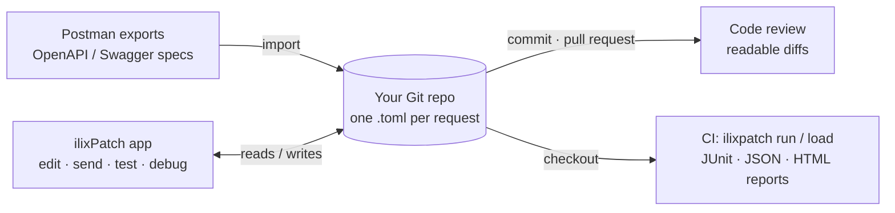

<p align="center">
  
</p>

<h1 align="center">ilixPatch</h1>

<p align="center">
  <b>The open-source, local-first API client that lives in your Git repo.</b><br>
  A fast Postman alternative: collections, environments, <code>pm.*</code> scripts and tests, load testing,
  OpenAPI import and a built-in Git client. No account, no cloud — your requests are plain files.
</p>

<p align="center">
  <a href="https://github.com/jst7/ilixPatch/actions/workflows/ci.yml"></a>
  <a href="https://github.com/jst7/ilixPatch/releases"></a>
  <a href="#license"></a>
  
</p>

<p align="center">
  <a href="https://github.com/jst7/ilixPatch/releases"><b>Download</b></a> ·
  <a href="#quick-start">Quick start</a> ·
  <a href="#how-it-works">How it works</a> ·
  <a href="docs/CLI.md">CLI docs</a> ·
  <a href="README.es.md">Leer en castellano</a>
</p>

> **Status: early development (0.x).** Things move fast and the on-disk format may still change.

## Why ilixPatch
- **Fast and light**: Rust core + [Tauri](https://tauri.app) (the OS webview, not a bundled Chromium).
  Starts quickly, uses little memory, and keeps big responses in Rust.
- **Local-first**: no sign-up, no sync, no telemetry. Everything lives in your project folder.
- **Git-native**: one TOML file per request → clean diffs, pull-request reviews, and an IntelliJ-style Git client inside the app.
- **Postman-compatible where it matters**: `pm.*` scripts and Chai assertions run unchanged, the CLI takes Newman's flags,
  and Postman collections, environments and data dumps import in a few clicks.
- **OpenAPI / Swagger in seconds**: paste a spec URL or drop a JSON/YAML file and get a ready-to-send collection,
  with example bodies generated from the schemas.
- **Same files, same engine, in CI**: the `ilixpatch` CLI runs your collections and load tests with JUnit/JSON/HTML reports.

## Quick start
1. **[Download](https://github.com/jst7/ilixPatch/releases)** the app for macOS, Windows or Linux.
2. Bring your requests: **+ › Import (Postman, OpenAPI)…** — drop a Postman export, or paste a spec URL such as
   `https://petstore3.swagger.io/api/v3/openapi.json`. Or open the bundled demo with **+ › Open folder…** → `examples/demo-project`.
3. Pick an environment and press **`⌘/Ctrl + Enter`**.

Then commit the project folder: your teammates get the same requests with `git pull`, and CI can run them:

```sh
ilixpatch run . --env staging -r cli,junit --reporter-junit-export results/junit.xml
```

What a run looks like, against the bundled demo project (abridged):

```text
$ ilixpatch run examples/demo-project --env dev
JSONPlaceholder
❏ posts
↳ List posts
  GET https://jsonplaceholder.typicode.com/posts?userId=1 [200 OK, 2.7kB, 66ms]
  │ post_id = 1
  ✓  Status is 200
  ✓  Content-Type is JSON
  ✓  Every post belongs to the user
…
┌────────────────────┬──────────┬────────┐
│                    │ executed │ failed │
├────────────────────┼──────────┼────────┤
│         iterations │        1 │      0 │
│           requests │        7 │      0 │
│       test-scripts │        6 │      0 │
│ prerequest-scripts │        1 │      0 │
│         assertions │       14 │      0 │
└────────────────────┴──────────┴────────┘
```

## How it works
Your API workspace is a folder of small TOML files — usually inside the repository of the API it tests.
The app and the CLI read and write exactly those files; there is no database or server in between.



```text
my-api/                         ← your repository
├── .ilixpatch/
│   ├── config.toml             ← marks the project
│   └── environments/
│       ├── staging.toml        ← shared variables (committed)
│       └── staging.secret.toml ← tokens & passwords (git-ignored)
└── users-api/                  ← a collection
    ├── collection.toml         ← variables, auth inherited by every request
    └── users/
        └── create-user.toml    ← one request = one file
```

```toml
# users-api/users/create-user.toml
name = "Create user"
method = "POST"
url = "{{baseUrl}}/users"

[body]
type = "json"
content = '''{ "name": "Ada", "email": "ada@example.com" }'''

[scripts]
tests = '''
pm.test("created", () => pm.response.to.have.status(201));
pm.environment.set("userId", pm.response.json().id);
'''
```

Requests are sent by a Rust engine (reqwest + rustls), not by a browser: no CORS, full control over TLS,
client certificates and proxies, and descriptive errors when something fails.

## Coming from Postman?
1. Export your collections and environments (or **Settings › Data › Export data** for everything) and import them:
   folders, auth (including inherited), bodies and variables come along; secret-looking values go to git-ignored files.
2. Your pre-request and test scripts keep working: `pm.test`, `pm.expect`, `pm.response`, `pm.environment`,
   `pm.variables`, `postman.setNextRequest`, Chai…
3. In CI, replace `newman run` with `ilixpatch run`: the flags (`-e`, `-d`, `-n`, `-r cli,junit,html`, `--bail`,
   `--folder`, `--env-var`, `--ssl-client-cert`…) and the exit codes are the same.

## Run it in CI
The CLI is a single binary. In GitHub Actions:

```yaml
- name: Install ilixpatch
  run: |
    V=v0.4.2   # pin the version you want
    curl -sSL "https://github.com/jst7/ilixPatch/releases/download/$V/ilixpatch-$V-x86_64-unknown-linux-gnu.tar.gz" | tar xz
    echo "$PWD/ilixpatch-$V-x86_64-unknown-linux-gnu" >> "$GITHUB_PATH"

- name: API tests
  run: |
    ilixpatch run . --env staging --env-var token=${{ secrets.API_TOKEN }} \
      -r cli,junit --reporter-junit-export results/junit.xml

- name: Load test (fails the job if p95 > 300 ms or more than 1% errors)
  run: ilixpatch load ./users-api --env staging --vus 20 --duration 1m --max-p95 300 --max-error-rate 0.01
```

Every command and flag is documented in **[docs/CLI.md](docs/CLI.md)** (Spanish).

## Features
**Requests & editor**
- HTTP methods with colour-coded selector, multi-line URL, params, headers, JSON/text bodies and key-value
  **form bodies** (`x-www-form-urlencoded`).
- **Paste a cURL command** into the URL bar to fill in the whole request; **Copy as cURL** (resolved or with `{{variables}}`).
- CodeMirror editors: JSON highlighting, folding, regex + multi-line search & replace, `pm` autocompletion.
- Cancel a hung request instantly (`⌘.` / `Ctrl+.`); **descriptive errors** that explain the likely cause
  (DNS, connection refused, timeout, TLS issuer/expiry/hostname, mTLS, proxy…) with one-click fixes.
- Response viewer: status, time, size, headers, tests, console, HTTP version, redirect chain and TLS certificate;
  folding, search and line wrapping for long values.
- **Authorization** with every Postman type: Bearer, Basic, API key, Digest, OAuth 1.0, **OAuth 2.0** (authorization code,
  PKCE, client credentials, password, implicit — tokens stay on your machine), AWS Signature v4, Hawk, NTLM, Akamai, JWT, ASAP.

**Organisation**
- **Project › Collection › Folder › Request**, each project usually a Git repository.
- **Project environments** (shared via Git; secrets kept in a git-ignored `.secret.toml`) and **global environments** (per user),
  copyable both ways. Collection & environment variables with Postman precedence.
- Open requests as tabs in a collapsible right sidebar; search the tree, the tabs and the history.
- **Quick requests**: start a new request at any moment (`⌘/Ctrl+N` or the **+** in the tabs panel) without picking a
  project first; decide where it goes when you save it (`⌘/Ctrl+S`). Unsaved ones survive a restart.
- **History** of every call with its response (local SQLite, retention by days and size), restorable into a new tab.

**Import**
- **Postman**: collections v2.0/v2.1, environments, globals and the *Export data* ZIP.
- **OpenAPI 3.0 / 3.1 and Swagger 2.0**: JSON or YAML, from a file or a URL. Folders by tag or by URL path, parameter and
  body examples (generated from the schema when missing), auth from the security schemes.
- A wizard shows what will be created and lets you **drag each item wherever you want** in your project.

**Scripts, tests and automation**
- Pre-request and test scripts with the Postman `pm.*` API on an embedded QuickJS engine (Chai `expect`, `pm.response`,
  variables, `setNextRequest`, legacy `tests[...]`).
- **Collection runner** (iterations, CSV/JSON data, delays, bail) and **load testing** (virtual users, fixed/ramp/spike/peak
  profiles, p50–p99 latency, live charts).
- **CLI** `ilixpatch` — a Newman-compatible runner for CI with JUnit/JSON/HTML reports and load-test thresholds.

**Git**
- Any project, collection or folder can be its own repository with its own branch (badge in the tree).
- Changes with semantic request diffs, commit, branches, fetch/pull/push, history with commit details,
  revert / reset / cherry-pick, **3-way merge conflict resolver**, **Annotate (blame)** in the editors, clone from the UI.

**Network**
- SSL verification, extra CA certificates, **client certificates (mTLS)** per host (PEM or PKCS#12), proxy (system/custom,
  http/https/socks5), redirects, timeouts, TLS version, HTTP/1.1 vs HTTP/2 — globally and per request.
  CORS doesn't apply: requests are sent by the Rust engine, not the browser.

**Make it yours**
- Light/dark/system themes and fully customizable colours (export/import), English and Castellano UI (more languages welcome).
- Tells you when a new version is published (a daily check against GitHub releases that you can turn off).

## Download
Pre-built installers and CLI binaries are published on the **[Releases](https://github.com/jst7/ilixPatch/releases)** page:

| Platform | App | CLI |
|---|---|---|
| macOS (Apple Silicon / Intel) | `.dmg` | `ilixpatch-<version>-aarch64-apple-darwin.tar.gz` / `x86_64-apple-darwin` |
| Windows | `.msi` / `.exe` | `ilixpatch-<version>-x86_64-pc-windows-msvc.zip` |
| Linux | `.deb` / `.rpm` / `.AppImage` | `ilixpatch-<version>-x86_64-unknown-linux-gnu.tar.gz` / `aarch64` |

Early builds may be **unsigned**: on macOS, right-click the app → *Open* the first time (or
`xattr -dr com.apple.quarantine /Applications/ilixPatch.app`); on Windows, SmartScreen → *More info* → *Run anyway*.

## Build from source
### The quick way
```sh
git clone https://github.com/jst7/ilixPatch.git
cd ilixPatch
./init.sh
```
`init.sh` detects your OS (macOS, Debian/Ubuntu, Fedora, Arch, openSUSE, WSL, Git Bash), checks the prerequisites,
offers to install what's missing (it asks first), installs the frontend dependencies and starts the app.

| Command | What it does |
|---|---|
| `./init.sh` | Check + install missing prerequisites + run the desktop app in dev mode |
| `./init.sh --check` | Only check prerequisites; changes nothing |
| `./init.sh --yes` | Install missing prerequisites without asking |
| `./init.sh --cli` | Run the CLI against the demo project |
| `./init.sh --build` | Build release installers into `target/release/bundle/` |

### Manual setup
Requirements: [Rust](https://rustup.rs) ≥ 1.85, Node.js ≥ 24 (LTS), Git, and the
[Tauri prerequisites](https://tauri.app/start/prerequisites/) for your OS (Xcode Command Line Tools on macOS;
WebKitGTK 4.1 & friends on Linux; MSVC Build Tools + WebView2 on Windows).

```sh
cd app
npm ci
npm run tauri dev        # desktop app with hot reload
npm run tauri build      # installers in ../target/release/bundle/

cd ..
cargo run -p ilixpatch-cli -- run examples/demo-project --env dev   # CLI
cargo build --release -p ilixpatch-cli                             # → target/release/ilixpatch
```

### Try it
Open the bundled demo with **+ › Open folder…** → `examples/demo-project`, pick the `dev` environment and press `⌘/Ctrl+Enter`.
Or import your own work with **+ › Import (Postman, OpenAPI)…**.

## CLI (Newman-compatible runner and load testing)
`ilixpatch run` runs a project, collection, folder or single request `.toml`,
including pre-request and test scripts (`pm.*` API, like Postman/Newman).
Full reference (in Spanish): [docs/CLI.md](docs/CLI.md).

```sh
ilixpatch run examples/demo-project --env dev
ilixpatch run examples/demo-project/jsonplaceholder/users \
  -e dev -d examples/demo-project/data/users.csv \
  -r cli,junit,html --reporter-junit-export results/junit.xml \
  --reporter-html-export results/report.html
```

| Flag | Meaning |
|---|---|
| `-e, --env <name\|file>` | Project environment (`.ilixpatch/environments/`), else a legacy collection environment (`<collection>/environments/`), else a path to an environment `.toml` / Postman environment `.json` |
| `--global-env <name>` | Use one of the desktop app's global (user-level) environments instead |
| `--no-globals` | Don't load the desktop app's `globals.toml` as `pm.globals` |
| `-n, --iteration-count <n>` | Iterations (default: rows of the data file, or 1) |
| `-d, --iteration-data <file>` | CSV (header row) or JSON (array of objects); one iteration per row (`pm.iterationData`, `{{column}}`) |
| `--delay-request <ms>` / `--timeout-request <ms>` | Delay between requests / per-request timeout |
| `--bail` | Stop on the first failed request or test |
| `--folder <name>` | Only run this folder (repeatable) |
| `-r, --reporters cli,json,junit,html` | Reporters; `--reporter-{json,junit,html}-export <path>` set the output files |
| `--export-environment <path>` | Write the final environment (Postman JSON) |
| `--global-var k=v`, `--env-var k=v` | Set globals / override environment variables (repeatable) |
| `-k, --insecure` | Accept invalid TLS certificates |
| `--ssl-client-cert <pem\|p12>`, `--ssl-client-key <pem>`, `--ssl-client-passphrase <p>` | Client certificate (mTLS) for every host |
| `--ssl-client-cert-list <json>` | Newman list: `[{name, matches: ["https://api.example.com/*"], cert, key, pfx, passphrase}]` |
| `--ssl-extra-ca-certs <pem>` | Extra trusted CA certificates |
| `--ignore-redirects` | Don't follow redirects |
| `--proxy <url>` (+ `--proxy-bypass <hosts>`), `--no-proxy` | Custom proxy (http, https, socks5, socks5h) / ignore system and env proxies |
| `--use-app-settings` | Start from the desktop app's network settings (`network.toml`); the flags above override them |
| `--suppress-exit-code`, `--verbose` | Always exit 0 / print response headers and bodies |

Variables resolve with precedence local > iteration data > environment >
collection > globals, and script changes persist across requests of the run.

The CLI shares global environments and globals with the desktop app: they live
in the app config dir (`<OS config dir>/dev.ilixpatch.app/`, e.g.
`~/Library/Application Support/dev.ilixpatch.app` on macOS,
`~/.config/dev.ilixpatch.app` on Linux, `%APPDATA%\dev.ilixpatch.app` on
Windows), as `environments/<name>.toml` and `globals.toml`. Set
`ILIXPATCH_CONFIG_DIR` to use another directory (e.g. in CI).
`postman.setNextRequest(name | null)` and `pm.execution.skipRequest()` work.
Exit code: `1` if any request errored or any test failed (a non-2xx status
without tests is not a failure, as in Newman), `2` on usage errors.

**Authorization** (all Postman types) is applied automatically by `run` and `load`,
after the pre-request script and variable resolution. Requests inherit it from
their folder (`folder.toml`) and collection (`collection.toml`), and every field
can use `{{variables}}`:

```toml
# collection.toml (or a request .toml, or <folder>/folder.toml)
[auth]
type = "bearer"
token = "{{token}}"
```

An explicit auth replaces a manual `Authorization` header (with a warning in the
logs, as in Postman). `no_auth` stops inheritance. Digest answers the server's
`401` challenge (or sends the header up-front when `realm` and `nonce` are set).
NTLM runs its handshake over a single keep-alive HTTP/1.1 connection, so it
does not work through proxies that close connections. For OAuth 2.0 the CLI
uses `access_token` when it is set (e.g. `access_token = "{{token}}"` with
`--env-var token=…`). Fetching tokens in the CLI (client_credentials /
password) goes through the OAuth 2.0 token provider. Interactive grants
(authorization code, PKCE, implicit) need a token obtained in the app.

`ilixpatch load` runs virtual users that loop over the target's requests:

```sh
ilixpatch load examples/demo-project/jsonplaceholder --vus 5 --duration 30s \
  --profile ramp-up --ramp-up 10s --think-time 100ms \
  --max-p95 500 --max-error-rate 0.01      # CI thresholds → exit 1 if exceeded
```

Profiles: `fixed`, `ramp-up` (linear up to `--vus`), `spike` (20% of the VUs,
100% during the middle 20% of the test) and `peak` (ramp up, hold, ramp down).
A request counts as an error on a network error, a status outside 2xx/3xx or a
failed test. `--no-scripts` skips scripts for maximum throughput. Please be
gentle with public APIs.

### Importing from Postman and OpenAPI
In the app: **+ › Import (Postman, OpenAPI)…** — drop files or paste a spec URL, pick what to import and drag it wherever
you want in your project.
From the command line:
```sh
ilixpatch import postman my-collection.postman_collection.json dev.postman_environment.json \
  --project ./my-project [--into ./my-project/api] [--env-scope project|global] [--on-conflict rename|overwrite|skip]
```
Collections v2.0/v2.1, environments, globals and the *Export data* `.zip` are supported. Auth (incl. inherited) is converted
to headers/scripts, collection/folder scripts can be inlined, and secret-looking variables go to git-ignored files.

```sh
ilixpatch import openapi https://petstore3.swagger.io/api/v3/openapi.json --project ./my-project \
  [--into ./my-project/api] [--group-by tags|path] [--on-conflict rename|overwrite|skip]
```
OpenAPI 3.0/3.1 and Swagger 2.0 (JSON or YAML, files or URLs): one collection per spec with a `baseUrl` variable, one
request per operation (folders by tag or by URL path), parameter and body examples (generated from the schema when
missing) and auth from `security`. Details in [docs/CLI.md](docs/CLI.md#ilixpatch-import-openapi).

## Project format
Everything is plain TOML in your repo: **Project > Collection > Folder > Request**.

```text
my-project/                  # usually a git repo
├── .ilixpatch/
│   ├── config.toml          # marks the project root
│   └── environments/        # project environments, shared by every collection
│       ├── dev.toml         # name + [[variables]]; secret ones keep only their key here
│       └── dev.secret.toml  # git-ignored: the secret values (tokens, passwords)
├── users-api/               # a collection = any subdirectory with collection.toml
│   ├── collection.toml      # name, format version, collection variables, auth
│   └── users/               # folders nest freely (folder.toml for folder auth)
│       └── list-users.toml  # one request per file
└── billing-api/
    └── collection.toml
```

An environment file:

```toml
name = "Dev"

[[variables]]
key = "base_url"
value = "https://dev.example.com"

[[variables]]
key = "token"
secret = true                # the value goes to dev.secret.toml, never to the repo
```

Global environments (per user, never in a repo) live in the app's config directory. Older projects with
`<collection>/environments/*.toml` still work: `--env` looks there when the project has no environment with that name.

`.ilixpatch/config.toml`:

```toml
version = 1
name = "My API"
# optional, relative to the project root; default "."
collections_dir = "."
```

Collections are the direct subdirectories of `collections_dir` that contain a
`collection.toml` (hidden directories, `node_modules` and `target` are skipped).
Adding a folder in the app creates `.ilixpatch/config.toml` for you if it is missing.
The CLI accepts either a project or a single collection directory; in a project,
`--env` applies to every collection that defines that environment.

A request file:

```toml
name = "Create post"
method = "POST"
url = "{{base_url}}/posts"

[headers]
Accept = "application/json"

[body]
type = "json"
content = '''{ "userId": {{user_id}} }'''
```

Variables resolve with increasing priority: globals → collection → environment → iteration data → local (`pm.variables`).

## Keyboard shortcuts
| Shortcut (macOS / Windows·Linux) | Action |
|---|---|
| `⌘ N` / `Ctrl N` | New request (not in any project until you save it) |
| `⌘ Enter` / `Ctrl Enter` | Send the request (Enter in the URL field too) |
| `⌘ .` / `Ctrl .` | Cancel the request in progress |
| `⌘ S` / `Ctrl S` | Save (a new request asks where to save it) |
| `⌘ W` / `Ctrl W` | Close tab |
| `Ctrl Tab` / `Ctrl Shift Tab` | Next / previous tab |
| `⌘ \` / `Ctrl \` | Toggle the tabs sidebar |
| `⌘ P` / `Ctrl P` | Search the project tree (or the history) |
| `⌘ E` / `Ctrl E` | Search open tabs |
| `⌘ F` / `Ctrl F` | Find in the editor (regex, multi-line) |
| `⌘ ⌥ F` / `Ctrl Alt F` (or `Ctrl H`) | Find & replace |
| `F7` / `Shift F7` | Next / previous conflict in the merge resolver |

## Architecture
A Cargo workspace; the UI and the CLI are thin shells over UI-agnostic crates.

| Crate | Purpose |
|---|---|
| `crates/core` | Data model, `{{variables}}`, on-disk format, projects, environments |
| `crates/engine` | HTTP engine (reqwest + rustls): TLS/mTLS, proxy, redirects, timing, error classification |
| `crates/scripting` | Postman-compatible `pm.*` sandbox on QuickJS (+ Chai) |
| `crates/runner` | Request pipeline, Newman-compatible collection runner, load testing, reporters |
| `crates/history` | Request history in SQLite with retention |
| `crates/git` | Multi-repository Git client (gix for reads, system `git` for writes and network) |
| `crates/importer` | Postman and OpenAPI / Swagger importer |
| `crates/cli` | The `ilixpatch` binary |
| `app/` | Tauri v2 desktop app: Svelte 5 frontend in `app/src`, Rust commands in `app/src-tauri` |

Design decisions (and the reasons behind them) are recorded in **[docs/DECISIONS.md](docs/DECISIONS.md)** (Spanish).

## Development
```sh
cargo fmt --all && cargo clippy --workspace --all-targets -- -D warnings && cargo test --workspace
cd app && npm run check && npm run build
for f in src/lib/*/selftest.mjs src/lib/curl.selftest.mjs; do node "$f" || break; done
```
- **CI** (`.github/workflows/ci.yml`) runs all of the above on Linux, macOS and Windows, plus an end-to-end CLI run of the demo project.
- **Third-party licenses**: `THIRD_PARTY_LICENSES` is generated by `node scripts/third-party-licenses.mjs` (also on every
  `npm run build`) and shown in the app under *About › Third-party licenses*. CI fails if it's out of date.
- **App icon**: edit `app/src-tauri/icons/icon.svg`, then `cd app && npx tauri icon src-tauri/icons/icon.svg`.

### Releasing
**With the script** (recommended): push your commits to `main`, wait for CI to be green, then run
`node scripts/release.mjs` — it asks *major / medium / minor*, checks (with `gh`) that CI passed on
that commit, bumps the version everywhere, commits, tags and pushes. `--dry-run` shows what it would do.

**By hand:**
1. Bump the version in `Cargo.toml` (`[workspace.package]`), `app/src-tauri/tauri.conf.json` and `app/package.json`.
2. Commit and push, then tag that commit and push the tag:
   `git tag -a vX.Y.Z -m "ilixPatch X.Y.Z" && git push origin vX.Y.Z` (the tag must match the version).
3. The **Release** workflow runs the whole **CI first** (nothing is built if a test fails), then builds the installers
   (macOS arm64 + x64, Windows, Linux) and the CLI for 5 targets into a draft GitHub Release, and **publishes it
   automatically** when every build succeeded. If a build fails, the release stays as a draft.
   A tag with a trailing letter (`vX.Y.Zb`) rebuilds the same app version.
4. Optional signing: add the `APPLE_*` secrets listed at the top of `.github/workflows/release.yml` for signed and
   notarized macOS builds; Windows signing is configured via `bundle.windows.signCommand`.

## Contributing
Issues and pull requests are welcome! Please skim [docs/DECISIONS.md](docs/DECISIONS.md) first and run the
checks from [Development](#development) before opening a PR. Good first areas: importers, CLI reporters, translations
(`app/src/lib/i18n/locales/`), and themes.

## License
Dual-licensed under [MIT](LICENSE-MIT) or [Apache-2.0](LICENSE-APACHE), at your option.
Third-party components are listed in [THIRD_PARTY_LICENSES](THIRD_PARTY_LICENSES).

## Author
Created by **Jorge Segovia Tormo** — [@jst7](https://github.com/jst7).
